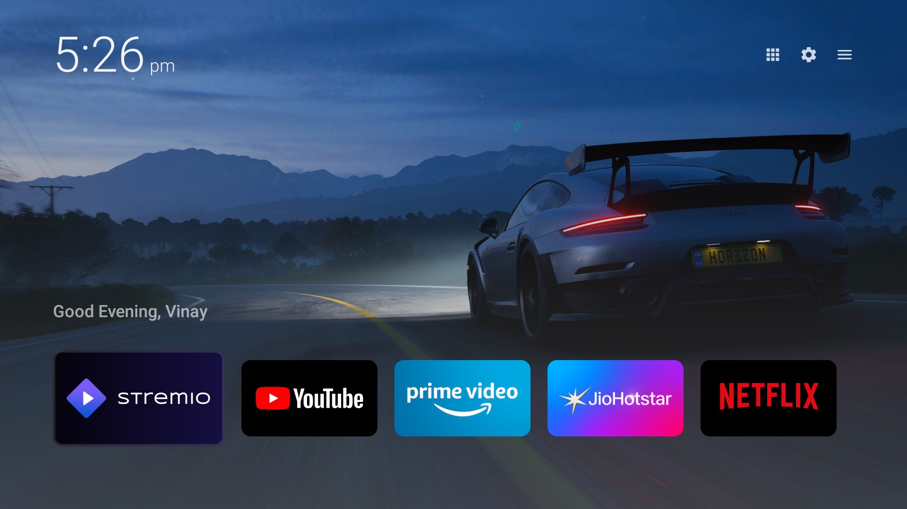
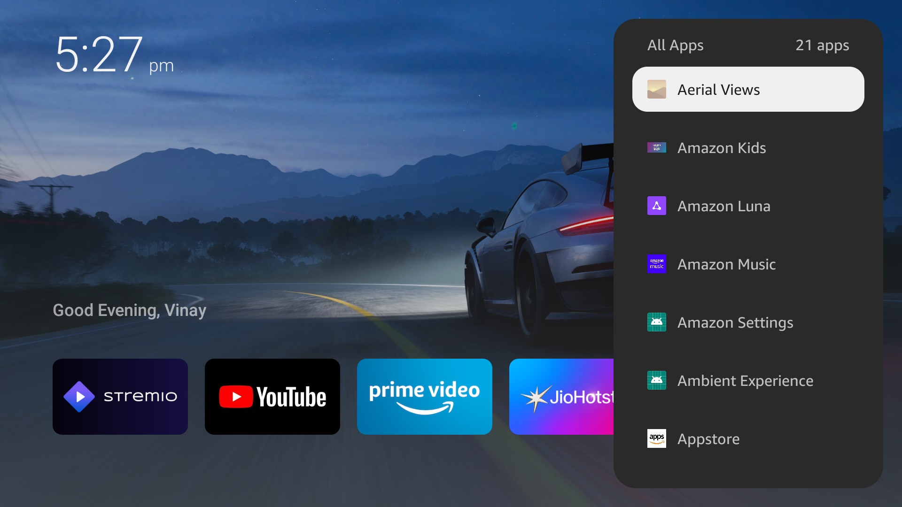
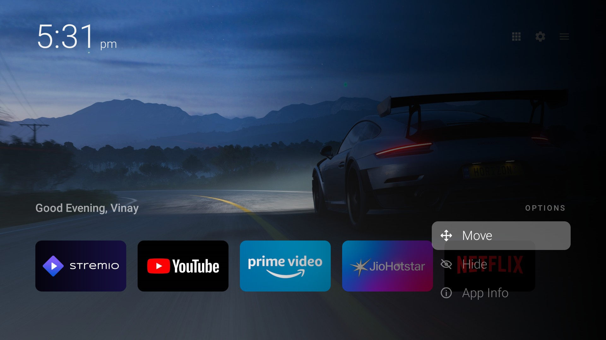
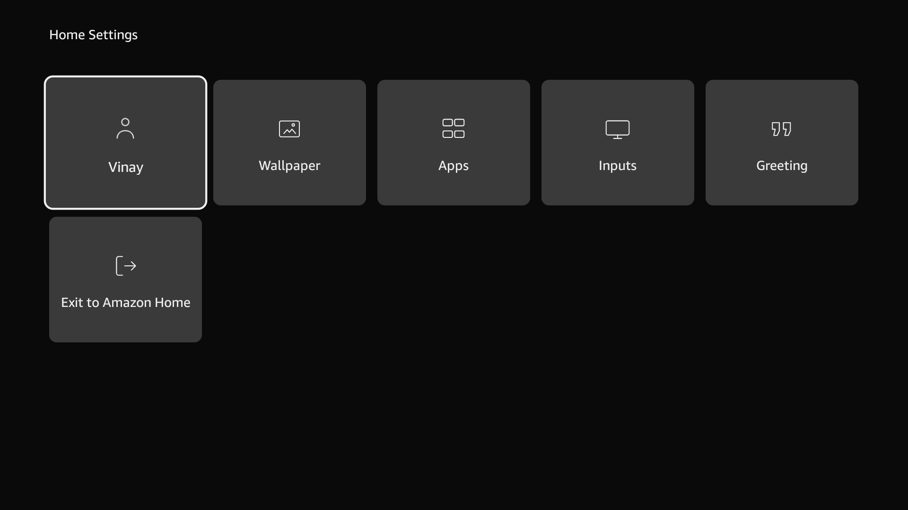
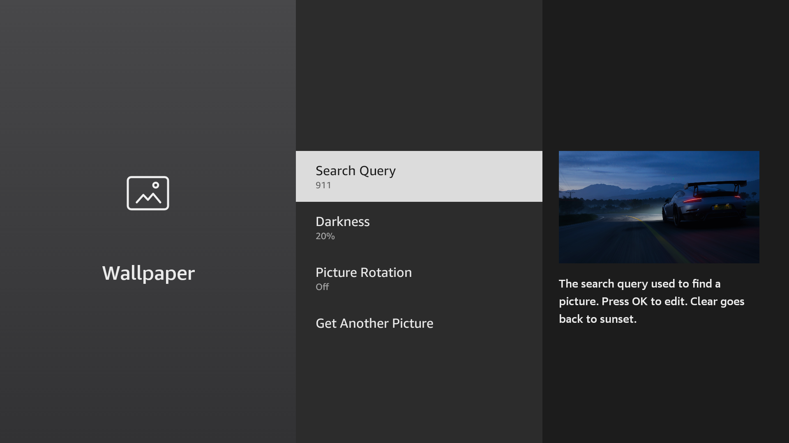
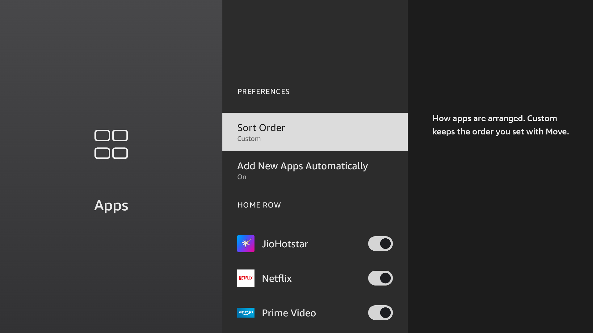
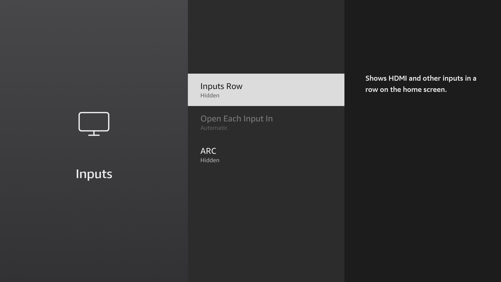
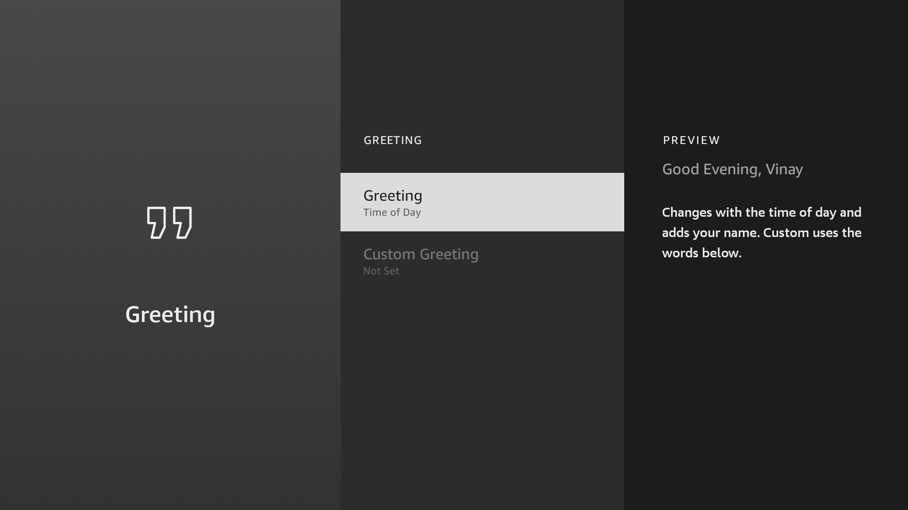

<p align="center"><b>Dumb TV Clean</b><br>
A Fire TV home screen in the same language as Fire TV settings. Clean, and polished.</p>

<p align="center">
  Thanks to <a href="https://github.com/humblemuzzu">Muzzammil</a> for the original
  <a href="https://github.com/humblemuzzu/dumbtv">dumbtv</a>.<br>
  This home screen is by Vinay Sajjanapu.
</p>

<p align="center">
  
</p>

It is drawn the way the television already draws its own screens. Amazon Ember, the type on the device. Dark tiles. A white outline that grows a little on the tile in focus. Settings in three panes, and a focused row that turns into a light bar with dark text. What you get is your apps, a clock, a greeting and a wallpaper.

Plain Java. No AndroidX, no Kotlin, no Compose, no Play Services. The application id is `tv.vinay.dumbtv`. Fetching a wallpaper you asked for is the only time it uses the network. On Fire OS 7 and 8 that is the only permission. There are no ads, no recommended rows, no account and no analytics.

## Home

The time is on the left. The greeting follows the time of day, and your name is added when you set one: "Good Evening, Vinay". The wallpaper fills the screen. Apps sit in one row. YouTube and Netflix use their own tile art. Every other app keeps the banner it shipped with.

All Apps, System Settings and Home Settings are at the top right. The name shows under the icon that has focus. OK opens the app in focus. Hold OK, or press ☰ Menu, for Move, Hide and App Info. In Move, left and right slide the tile and any other key drops it. Hold HOME still opens Fire OS's own menu.

## All Apps

<p align="center">
  
</p>

The grid icon opens every installed app, including the ones kept off the home row. OK opens the app. Hold OK and a small menu sits beside that name: App Info, or add it to the home row and take it off again. Back closes the menu, then the list.

## On a tile

<p align="center">
  
</p>

## Home Settings

<p align="center">
  
</p>

The same shape as Fire TV settings. Six tiles.

| Tile | What it does |
|---|---|
| Your Name | The name in the greeting. The tile shows it once you set one. OK edits it. Blank leaves "Good Evening" |
| Wallpaper | Search query, how dark the picture sits, picture rotation, and a new picture now |
| Apps | Sort order, whether a new app joins the home row, and which apps are on that row |
| Inputs | The inputs row, which inputs appear, and where each one opens |
| Greeting | Time of day, or your own words |
| Exit to Amazon Home | Leaves Dumb TV Clean and opens Amazon's launcher |

## Wallpaper

<p align="center">
  
</p>

Search Query, Darkness, Picture Rotation, and Get Another Picture. The right side is a 16:9 preview, and a short note sits with the row in focus. Left and right, or OK, change that row. OK on Search Query opens the editor.

The picture comes from [Wallhaven](https://wallhaven.cc), general and safe. A blank search looks for abstract dark. Darkness applies straight away. Picture Rotation can stay off, or ask for another every time you come home, every hour, every day, or as morning, afternoon and night change. Get Another Picture asks now. A restart shows the same picture. Nothing else in the app opens a connection.

## Apps

<p align="center">
  
</p>

Sort Order is Custom, Alphabetical, or Recently Used. Custom keeps the order you set with Move. Add New Apps Automatically is On or Off, changed the same way, with left and right or OK. On puts a newly installed app on the home row. Apps already on the television stay as they are.

Home Row lists every installed app. The switch puts that app on the home screen or takes it off. An app that is off here is still in All Apps.

## Inputs

<p align="center">
  
</p>

The inputs row stays hidden until you turn it on. Inputs Row is Shown or Hidden. Open Each Input In is Automatic, The TV's App, or Dumb TV Clean. Each input is listed under that, and each one can be shown or hidden.

## Greeting

<p align="center">
  
</p>

Time of Day follows the clock and then your name. Custom Greeting replaces that whole line. Clear it and the time-of-day greeting comes back. The pane on the right is the line the home screen will show.

## Install

You need `adb`, a JDK 17, and the Android SDK. On the TV: **Settings → My Fire TV → About**, press OK on the device name 7 times, then **Developer Options → ADB debugging**. The IP address is under **Settings → My Fire TV → About → Network**.

The home screen on its own:

```sh
git clone https://github.com/vinaysajjanapu/dumbtv-clean && cd dumbtv-clean
adb connect <tv-ip>:5555        # press Allow on the TV
./launcher/install.sh           # build from source, install, take over HOME
```

Undo: `./launcher/install.sh --undo` gives HOME back to Amazon's launcher.

The rest of the cleanup, packages and the DNS filter included, asks before it changes anything:

```sh
adb connect <tv-ip>:5555
./scripts/preflight.sh          # what the TV is and what would change; changes nothing
./scripts/configure.sh          # a few questions
./scripts/all.sh                # asks before each step, reboots the TV twice
./scripts/verify.sh             # checks the result
```

Works from macOS, Linux and Windows (WSL or Git Bash). `configure.sh` asks whether you watch Prime Video, whether to keep Alexa, whether to replace the home screen, whether to run the DNS filter, which apps to remove, and whether to replace YouTube with SmartTube. The answers are saved in `dumbtv.conf`.

```sh
./scripts/restore.sh
```

gives the television back: packages, settings, the filter and HOME.

Build details, the signature key and the JDK are in [launcher/README.md](launcher/README.md).

## Licence

Scripts, docs and the launcher are [MIT](LICENSE).
